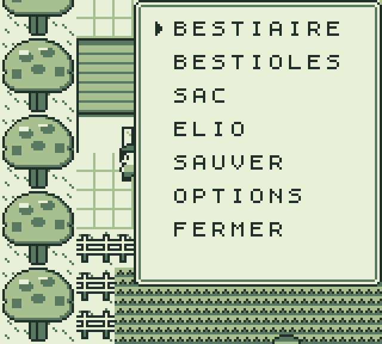

# Bestiora Azur

RPG original de capture de créatures en pixel art 4 teintes (160 × 144), pour Windows, macOS, Linux et navigateur. On y parcourt la péninsule de Brumeval, on capture et entraîne 150 bestioles, on affronte 8 champions d'arène puis la Ligue. Tout est original : créatures, cartes, textes et musiques composées pour le jeu, synthétisées en temps réel.

| Écran titre | Ville | Menu | Combat |
|---|---|---|---|
|  |  |  |  |

## Installation

Les installeurs sont produits par `npm run dist` dans `dist/` :

| Plateforme | Fichier |
|---|---|
| Windows | `Bestiora Azur-Setup-1.0.0.exe` (installeur) ou `Bestiora Azur-1.0.0-portable.exe` (sans installation) |
| macOS | `Bestiora Azur-1.0.0.dmg` |
| Linux | `Bestiora Azur-1.0.0.AppImage` |

Les installeurs ne sont pas signés : Windows SmartScreen et macOS Gatekeeper demandent une confirmation au premier lancement.

## Commandes

Prérequis : Node.js 20 ou plus récent, puis `npm install`.

| Commande | Rôle |
|---|---|
| `npm start` | Lance le jeu |
| `npm run dev` | Lance avec DevTools et menu debug (`F1`) ; `npm run dev -- --newgame` part de l'écran titre |
| `npm test` | Tests unitaires |
| `npm run validate` | Valide les données (références, textes dans leur fenêtre, 150 espèces obtenables) |
| `npm run atlas` | Régénère les atlas PNG depuis les sources |
| `npm run icon` | Régénère l'icône (`build/icon.png`, `.ico`, `.icns`) |
| `npm run screenshots` | Régénère les captures de ce README |
| `npm run perf` | Mesure les images par seconde sur une carte dense et en combat |
| `npm run balance` | Équilibrage des combats importants |
| `npm run dist` | Construit les installeurs de la plateforme courante |

`npm run dist` ne construit que la plateforme sur laquelle il tourne : le `.dmg` se construit sur macOS, l'AppImage sur Linux ou macOS.

## Contrôles

| Action | Clavier | Manette |
|---|---|---|
| Se déplacer | Flèches | Croix ou stick gauche |
| Valider (A) | `X` | Bouton bas (A / Croix) |
| Annuler, courir (B) | `Z` (`W` sur AZERTY) | Bouton droit (B / Rond) |
| Menu (START) | `Entrée` | Start |
| SELECT | `Shift` droit | Select |
| Changer de palette | SELECT + START | SELECT + START |
| Plein écran | `F11` | |

Les touches et les boutons de manette se remappent dans OPTIONS (TOUCHES, MANETTE). Les options proposent aussi le texte instantané, la palette Contraste (contraste maximal) et la réduction des flashs (les clignotements de combat deviennent un léger décalage).

## Jouer sur iPhone (ou tablette)

Le jeu tourne aussi dans le navigateur, avec des contrôles tactiles (croix, A, B, START, SELECT).

1. Sur le PC : `npm run web`. Le terminal affiche les adresses du PC sur le réseau, par exemple `http://192.168.1.94:8080/`. Au premier lancement, autoriser Node.js dans le pare-feu Windows (réseau privé).
2. Sur l'iPhone, connecté au même Wi-Fi : ouvrir cette adresse dans Safari.
3. Partager, puis « Sur l'écran d'accueil » : le jeu s'ouvre ensuite en plein écran depuis son icône.

Les contrôles tactiles apparaissent seuls sur un écran tactile. L'option TACTILE (AUTO, OUI, NON) les force ou les masque. La sauvegarde est stockée dans le navigateur de l'iPhone, séparément de celle du PC. Le PC doit être allumé, avec `npm run web` lancé, au moment d'ouvrir le jeu.

### Version en ligne et hors ligne

Chaque push sur `main` publie la version web sur GitHub Pages (`.github/workflows/pages.yml`, construite par `npm run build-web`). Ouverte une fois en HTTPS, elle est gardée sur l'appareil par un service worker (`src/sw.js`) et démarre ensuite sans réseau. Une nouvelle version publiée est téléchargée au lancement suivant avec réseau, puis utilisée au lancement d'après. Le serveur local (`npm run web`, en HTTP) n'a pas de mode hors ligne.

### Clés d'activation (test privé)

La version web en ligne demande une clé liée à l'appareil ; la version PC et le serveur local (`npm run web`, HTTP) n'en demandent pas.

1. Le joueur ouvre le jeu (depuis l'icône de l'écran d'accueil sur iPhone) : l'écran « Test en cours » affiche l'identifiant de son appareil, par exemple `K7QM-2XRA`.
2. Il te l'envoie ; tu génères sa clé et la lui renvoies, il la colle dans le jeu.

```powershell
npm run key -- init                     # une seule fois : crée la paire de clés
npm run key -- new K7QM-2XRA "Prénom"   # clé pour cet appareil, aucun push nécessaire
npm run key -- list                     # appareils et clés créés sur ce PC
npm run key -- revoke "Prénom"          # révoque un appareil : commit et push ensuite
```

La clé est une signature de l'identifiant par ta clé privée (`access-private-key.local.pem`) ; le jeu ne contient que la clé publique (`src/data/access-public-key.js`), il peut vérifier une clé mais personne ne peut en fabriquer. Une clé ne marche que sur l'appareil pour lequel elle a été faite.

- Sauvegarder `access-private-key.local.pem` et `access-devices.local.json` (non versionnés). Sans la clé privée, plus aucune clé ne peut être créée, et refaire `init` invalide toutes les clés données.
- TOUT EFFACER ou l'effacement des données de Safari crée un nouvel identifiant : il faut alors une nouvelle clé. Sur iPhone, Safari et l'icône d'écran d'accueil ont des données séparées.
- Une révocation s'applique au deuxième lancement avec réseau après le push (mise à jour du cache hors ligne).
- Cette protection tient les curieux à l'écart ; quelqu'un de déterminé peut toujours copier le jeu et retirer le contrôle dans sa propre copie.

## Sauvegardes

La partie se sauvegarde depuis le menu START (SAUVER), sauf dans la Ligue une fois la porte franchie. Les fichiers sont dans le dossier de données de l'application :

| Plateforme | Dossier |
|---|---|
| Windows | `%APPDATA%\Bestiora Azur\` |
| macOS | `~/Library/Application Support/Bestiora Azur/` |
| Linux | `~/.config/Bestiora Azur/` |

- `save.json` : la sauvegarde, en JSON versionné (format dans [docs/ARCHITECTURE.md](docs/ARCHITECTURE.md)).
- `save.bak.json` : la sauvegarde précédente. Elle est chargée automatiquement si `save.json` est illisible.
- `options.json` : les options, indépendantes de la partie.
- `logs/` : un journal par jour des erreurs rencontrées.

Chaque écriture passe par un fichier temporaire renommé ensuite : un arrêt brutal pendant la sauvegarde laisse toujours la sauvegarde précédente intacte.

## Retoucher les graphismes

Les sprites sont décrits en texte dans `src/gfx/sources/` et assemblés en atlas PNG dans `assets/atlas/` par `npm run atlas`. Pour retoucher un atlas directement :

1. Ouvrir `assets/atlas/<atlas>.png` (`tiles`, `characters`, `trainers`, `creatures` ou `ui`) dans un éditeur de pixel art.
2. Dessiner uniquement avec les 4 gris de référence, du plus clair au plus foncé : `#ffffff`, `#aaaaaa`, `#555555`, `#000000`, plus la transparence. Le jeu les remplace par la palette choisie.
3. Ne pas déplacer les images : leurs positions sont dans `assets/atlas/<atlas>.json`.
4. Relancer le jeu pour voir la retouche.

`npm run atlas` réécrit les PNG depuis les sources et efface donc les retouches. `npm run atlas -- --keep-edited` conserve les PNG modifiés à la main depuis le dernier build.

## Documentation

- [docs/GAME_DESIGN.md](docs/GAME_DESIGN.md) : univers, mécaniques, contenu.
- [docs/ARCHITECTURE.md](docs/ARCHITECTURE.md) : organisation du code et formats.
- [docs/PROGRESS.md](docs/PROGRESS.md) : journal de développement.
- [docs/WEB_DEPLOIEMENT.md](docs/WEB_DEPLOIEMENT.md) : version web, iPhone, hors ligne et clés d'activation, à reprendre dans un autre jeu.
- [docs/apprendre/](docs/apprendre/README.md) : le code expliqué simplement, chapitre par chapitre (niveau CM2).

## Statut et licence

Projet personnel, non commercial, réalisé pour mon usage propre et à des fins de découverte. Il n'est ni vendu ni distribué publiquement : la version web est réservée à quelques testeurs munis d'une clé.

Le jeu ne reprend aucun contenu d'un jeu existant : personnages, créatures, lieux, textes, graphismes et musiques sont originaux (voir les règles d'originalité de [docs/GAME_DESIGN.md](docs/GAME_DESIGN.md)). Il n'est affilié à aucun éditeur de jeux vidéo.

Aucune licence de réutilisation n'est accordée : tous droits réservés.
